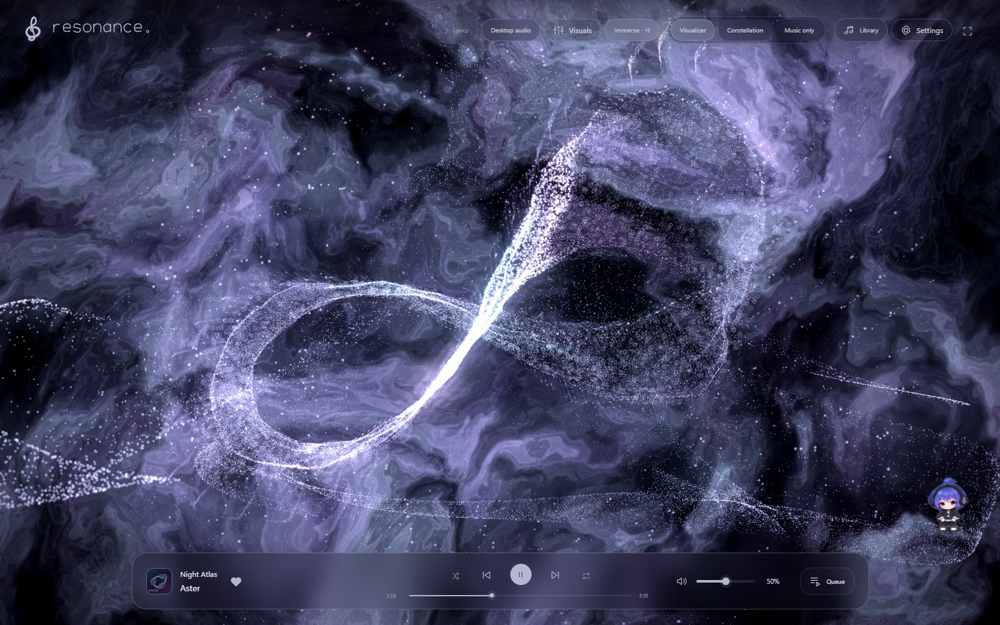
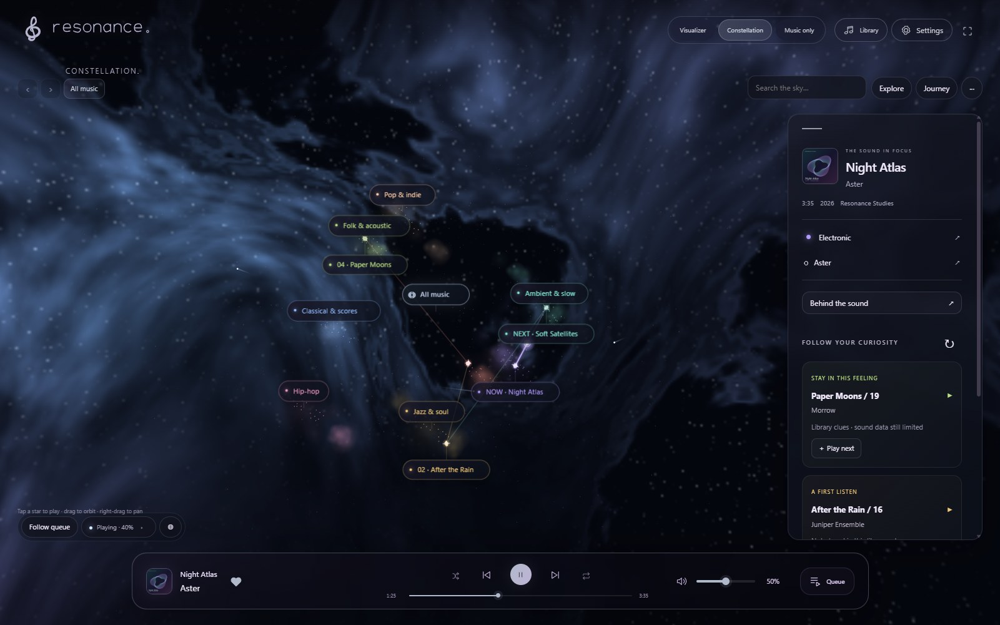
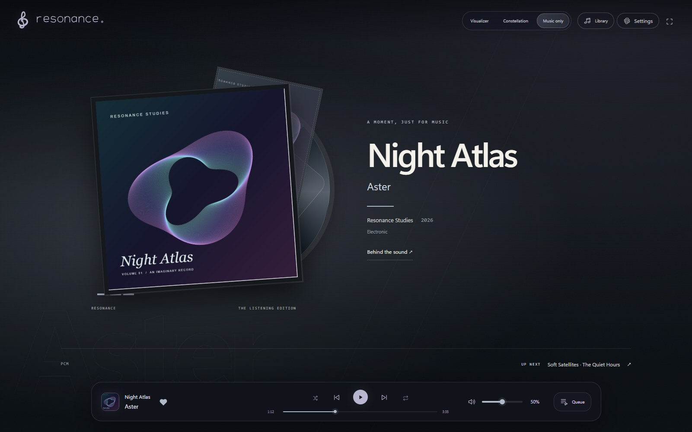

<p align="center">
  
</p>
<h1 align="center">Your music, in another light.</h1>
<p align="center">A local music player for Windows and Android.<br>One library. Three ways to get lost in it.</p>
<p align="center">
  <a href="https://hynekro.github.io/resonance/#downloads"><strong>Download the app</strong></a> ·
  <a href="https://hynekro.github.io/resonance/guide.html">Explore the features</a> ·
  <a href="https://github.com/HyneKro/resonance/releases">Release notes</a> ·
  <a href="https://github.com/HyneKro/resonance/issues">Report an issue</a>
</p>



**Feel the sound. Explore the collection. Settle into the artwork.** Resonance brings expressive visuals and thoughtful library tools to the music you keep. No Resonance account or subscription is needed. Bring your own audio files; no songs are included.

## Start listening

| Windows | Android |
| --- | --- |
| **64-bit portable ZIP** | **Android 10+ · ARM64 APK · preview** |
| Extract the whole ZIP and open `Resonance.exe`. | Open the APK and follow Android's installation steps. |
| Keep the `data` folder with the app. | Install over the previous version; don't uninstall to update. |

**[Get the latest Windows or Android build →](https://hynekro.github.io/resonance/#downloads)**

The download page always follows the latest published release for each platform. GitHub's green **Code → Download ZIP** button downloads source code, not the app.

Open **Library**, add a folder, and play a song. The mode switch chooses Visualizer, Constellation or Music only without interrupting playback. Click the playing cover or title for **Behind the sound**; Queue keeps listening history and upcoming songs together.

## Three ways to listen

### Visualizer — feel it

Ribbons, particles and an evolving atmosphere follow the music, with colors drawn from cover art. Orbit the scene, try camera rails and kaleidoscopes, or enable timed lyrics. Quality, motion and spectrum controls let you shape the result.

### Constellation — explore it



Every available song is a star. Navigate artist and genre groups, play a star, or follow the upcoming queue as light travels along its connections. Build a journey, review the route and play it now or after the current song. Discovery uses your own collection and its available metadata and sound profiles.

### Music only — stay a while



Cover artwork, sampled color and expressive typography form a quiet listening edition. Four treatments adapt to genre. Layers from the current cover drift slowly on Windows; Android and reduced-motion layouts remain still. Playback, song details and the next track remain close, while the animated scenes stop rendering.

*All previews use fictional song and artist names, original procedural demo artwork and synthetic audio. No personal collection or device data is shown.*

## More to explore

<details>
<summary><strong>A library with context</strong> — artist credits, genres and recording details</summary>

Browse artists, genres, favorites, recent plays, tracks and long mixes. Library review separates uncertain artist credits, missing genres and possible copies. Saved corrections take priority over automatic suggestions, with Undo available. Original audio files are not retagged, and possible duplicates are never automatically deleted.

Catalogue coverage is imperfect. Repost channels, ambiguous titles and unusual recordings can still need review.

**Smart collections** live in Library and fill themselves from your music. Start with the built-in collections or combine rules for artists, genres, favorites, listening history and duration. **Activity & checks** gathers background progress and quick actions for library maintenance.

[Library guide](https://hynekro.github.io/resonance/guide.html#library) · [How evidence and corrections work](docs/LIBRARY-UNDERSTANDING.md)

</details>

<details>
<summary><strong>Playback with care</strong> — loudness leveling, listening edits and EQ</summary>

Optional loudness leveling aims for a shared overall song loudness while preserving dynamics within the recording. Peak protection can limit gain. Silent-edge skipping marks skipped portions on the timeline; manual start/end points handle intros and outros without changing files. EQ and visual-sync adjustments are available; experimental crossfade is Windows-only.

[Sound guide](https://hynekro.github.io/resonance/guide.html#sound)

</details>

<details>
<summary><strong>Dynamic Lyrics</strong> — timed lines and a luminous text sweep</summary>

The Lyrics button becomes available in Visualizer when a song has timed lyrics. Actual word timings drive word fills; line-only timing gets an approximate phrase sweep. Plain lyrics remain readable in Behind the sound. Save a per-song offset or import a supported timed lyric file when needed.

Lyrics and timing depend on the recording and source. No recognition model is downloaded; the app does not transcribe songs.

[Lyrics guide](https://hynekro.github.io/resonance/guide.html#lyrics) · [Timing details](docs/LYRICS.md)

</details>

<details>
<summary><strong>Playlist imports</strong> — YouTube, Spotify and Deezer</summary>

Add supported public playlists, check for new entries and review recording matches before downloading. Spotify and Deezer supply playlist metadata; downloaded audio comes from your selected YouTube match, not those services. Genuine unavailable recordings can be matched to alternate uploads or music videos. Availability varies; use recordings you have permission to download.

[Import guide and limitations](https://hynekro.github.io/resonance/guide.html#imports)

</details>

<details>
<summary><strong>Live audio and Sona</strong> — a scene beyond your library</summary>

Windows desktop-audio mode reacts to other apps, with an optional microphone input. Capture drives the visuals and is not recorded or uploaded. Android uses system consent and can receive audio only from apps that permit capture.

Sona is the default optional companion, with additional appearances. Windows can keep the companion above other windows with compact playback controls.

[Live audio and companion guide](https://hynekro.github.io/resonance/guide.html#desktop-audio)

</details>

**[Read the complete feature guide →](https://hynekro.github.io/resonance/guide.html)** It includes controls, platform differences, installation help and what goes online.

## Updates and privacy

Both apps check GitHub for updates. Windows installs when you choose **Restart & update**; Android requires its system installer confirmation. Your library and settings are preserved. Windows automatically removes obsolete completed update files while retaining one rollback backup.

Local playback and sound measurements stay on the device. Online artwork, lyric and metadata lookups send song/artist search terms to providers. Downloads contact their source; update checks contact GitHub. **Transfer settings** moves shared preferences, playlist links and supported song customizations through a small file you export and import yourself. It does not move music or listening history, and there is no automatic PC-to-phone library sync. Keep exported files private: they contain your preferences and song/playlist details.

When reporting an issue, remove personal paths, names and playlist links from screenshots or diagnostics. Never upload library databases, cookies or credentials. See [privacy and help](https://hynekro.github.io/resonance/guide.html#privacy).

## For contributors and curious minds

Use **Node 24**. A fresh checkout starts with an empty library:

```sh
npm ci
npm start
```

`npm run dev` starts the browser version; `npm test` runs the regression suite. Optional local configuration belongs in ignored `config.json`; begin with `config.example.json`.

- [Documentation index](docs/README.md) — feature internals and design notes.
- [Android development](android/README.md) — native build, tests and device checks.
- [Sharing and updates](docs/SHARING.md) — packaging, publishing and retention.
- [Website maintenance](download-page/README.md) — automatic release links and public demo assets.

Automated tests and browser previews do not guarantee physical-device performance. Version-specific validation and limitations are recorded in the [release notes](docs/release-notes/).

Artwork and dependency notices are available in the app's Credits. The licensed skybox is included only in authorized app builds; public source builds use a procedural fallback. Personal music, databases, credentials, signing keys and used portable folders must never be committed or distributed.
